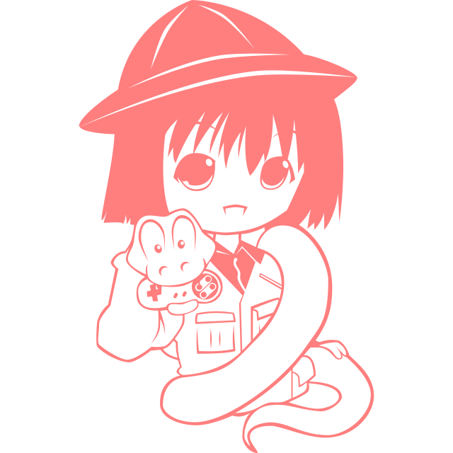

# Universal Ren'Py iOS Builder

Build Ren'Py games into unsigned iOS IPA files directly through GitHub Actions.

No local Mac or Xcode installation required. Provide your game name, Ren'Py SDK version, and release tag, and GitHub builds the IPA for you.

  

## Features

- **Universal:** Build different Ren'Py games using the same workflow.
- **Two workflows:** One for Ren'Py 8 games (Python 3) and one for Ren'Py 7 games (Python 2). See [Which workflow do I need?](#which-workflow-do-i-need)
- **Configurable:** Choose the Ren'Py SDK version.
- **Live2D support:** Optional, in the Ren'Py 8 workflow, using a Cubism SDK zip you provide (see [Live2D games](#live2d-games)).
- **Automated:** Downloads game assets and prepares the Xcode project.
- **Unsigned builds:** No Apple Developer certificate required during compilation.
- **Cloud-based:** Builds run on GitHub-hosted macOS runners.
- **Ready to download:** IPA files are uploaded as workflow artifacts.

## Which workflow do I need?

Ren'Py 7 and Ren'Py 8 use different Python versions, so a game built for one usually will not run on the other. Pick the workflow that matches the version your game was made with.

| | Ren'Py 8 workflow | Ren'Py 7 workflow |
|:---|:---|:---|
| File | `renpy8-ios.yml` | `renpy7-ios.yml` |
| Name in the Actions tab | Universal Ren'Py iOS Builder | Universal Ren'Py 7 iOS Builder |
| Python | 3 | 2 |
| Default SDK | `8.3.6` | `7.8.7` |
| Live2D | Supported | Not included yet |

If you are not sure which one your game uses:

- A game made with Ren'Py 8 uses Python 3. Use the **Ren'Py 8** workflow.
- A game made with Ren'Py 7 or earlier uses Python 2. Use the **Ren'Py 7** workflow.
- If the Ren'Py 8 workflow fails with Python 2 style errors such as `module 'time' has no attribute 'clock'` or `'function' object has no attribute 'func_code'`, the game was written for Ren'Py 7. Use the Ren'Py 7 workflow instead.

## Requirements

- A **Private GitHub** repository with Actions enabled.
- A Ren'Py game compatible with the selected SDK.
- A `game.zip` archive containing your game's `game` folder.

## Setup

### 1. Add the workflows

Clone the repo, or copy the workflow file you need into your own repository:

- `.github/workflows/renpy8-ios.yml` for Ren'Py 8 games
- `.github/workflows/renpy7-ios.yml` for Ren'Py 7 games

You only need the one that matches your game.

### 2. Prepare your game

Locate your Ren'Py project's `game` folder and compress it into:

`game.zip`

If your game ships its scripts and assets in an `archive.rpa`, include it inside the `game` folder, or attach it to the release as a separate file named `archive.rpa`.

### 3. Create a release

Create a GitHub Release and attach `game.zip`.

The default release tag is `1.0`, but you can use any tag when running the workflow.

## Live2D games

> [!NOTE]
> Live2D is only included in the Ren'Py 8 workflow. Ren'Py 7.5 and later can use Live2D, but the Ren'Py 7 workflow does not install the Cubism library yet, so Live2D games built with it will fail at launch.

If your game uses Live2D models, Ren'Py needs the Live2D Cubism Core library to build. Live2D does not allow redistribution of this library, so the workflow does not include it. You supply your own copy:

1. **Download the Cubism SDK for Native** from [Live2D's website](https://www.live2d.com/en/sdk/download/native/) and accept their license.
2. **Use version 5-r.4.1 or older.** Versions from 5-r.5 onward (Core 06) are not compatible with Ren'Py yet, and the build will stop with an error.
3. **Attach the zip, unchanged, to the same release as `game.zip`.** Its name must start with `CubismSdkForNative` (for example `CubismSdkForNative-5-r.4.1.zip`).
4. **Go to the `Actions` tab and run the Ren'Py 8 workflow.**

> [!IMPORTANT]
> Private repositories use GitHub Actions minutes, and macOS minutes are billed at a higher rate than Linux ones. Check your plan's allowance.

## Building

Go to **Actions**, choose the workflow that matches your game, and click **Run workflow**.

| Input | Description | Ren'Py 8 default | Ren'Py 7 default |
|:---|:---|:---|:---|
| `game_name` | Name of the game | Required | Required |
| `renpy_version` | Ren'Py SDK version | `8.3.6` | `7.8.7` |
| `release_tag` | Release containing `game.zip` (and the Cubism zip for Live2D games on Ren'Py 8) | `1.0` | `1.0` |

Once submitted, GitHub Actions will automatically:

1. Download the game assets (and the Cubism zip, if present, on Ren'Py 8).
2. Extract and prepare the Ren'Py project.
3. Download the specified Ren'Py SDK and iOS support package.
4. Install Live2D Cubism Core, if you provided it (Ren'Py 8 only).
5. Generate the Xcode project.
6. Compile the application without code signing.
7. Package the application into an IPA.
8. Upload the finished IPA as an artifact.

## Downloading the IPA

After a successful build:

1. Open the completed workflow run.
2. Find the **Artifacts** section.
3. Download the generated IPA.

Output naming:

`<GameName>-unsigned.ipa`

## Installing on iOS

The generated IPA is unsigned and cannot normally be installed directly on an iPhone.

You will need to sign it using a suitable sideloading solution:

- [AltStore](https://altstore.io/)
- [Sideloadly](https://sideloadly.io/)

A valid signing method and provisioning profile may be required.

## Troubleshooting

If a build fails, scroll up to find the **first** error in the log. Later errors (such as `Invalid window`) are usually side effects of the first one.

| Error | Cause and fix |
|:---|:---|
| `Launching the project failed` | Ren'Py could not start your game. Look for the first error in the log above this message. |
| `module 'time' has no attribute 'clock'`, `... no attribute 'func_code'`, or similar Python 2 errors | The game was written for Ren'Py 7 (Python 2) but is being built with a Ren'Py 8 SDK (Python 3). Use the **Ren'Py 7** workflow. |
| `Could not load Live2D ... libLive2DCubismCore.dylib was not found` | Your game uses Live2D but no Cubism zip was attached to the release. Attach one (see [Live2D games](#live2d-games)). |
| `This Cubism SDK is too new for Ren'Py` or `csmGetDrawableRenderOrders not found` | The Cubism SDK is version 5-r.5 or newer. Use 5-r.4.1 or older. |
| `Invalid window` | Ren'Py tried to show an error screen on the display-less build machine. It is a side effect of another failure, so look for the error above it. |
| Xcode errors in the Ren'Py 7 workflow | The Ren'Py 7 iOS templates are older than current Xcode, so build errors are more likely than with Ren'Py 8. Check the first compiler or linker error in the log. |

## Notes

- The selected SDK should match the version used to develop the game.
  > Sometimes this rule doesn't apply if the original SDK is too old or too new (nightly versions). Try newer stable releases.
- Ren'Py 7 games should use the Ren'Py 7 workflow, even if you want a newer SDK. The newest Ren'Py 7 release is the usual choice.
- Native extensions and additional dependencies may require modifications to the workflow.
- The game name determines the output filename, not necessarily the installed app's display name.
- Existing save files are excluded from the build.
- Workflow artifacts are retained for 14 days by default.

## Tested Games

| Game | Original SDK | Workflow SDK | Works? |
|---|---|---|---|
| Summertime Saga | 8.5.3 | 8.5.3 | ✅ Yes |
| Beast Control | 8.3.0 | 8.3.6 | ✅ Yes |
| Motel Heat | 8.5.0 | 8.5.0 | ✅ Yes |
| Edgefield | 8.3.6 | 8.3.6 | ✅ Yes |
| Monster Girl Tavern | 8.5.4 | 8.5.3 | ✅ Yes |
| Another Chance | 7.4.4 | 7.8.7 | ✅ Yes |

## License

- This project is a build tool provided for educational and personal use. Games listed were used only to test the workflow. This repo hosts no game files. All games belong to their owners.
- This repository contains an automated build workflow. Game assets, scripts, and third-party materials remain subject to their respective licenses.
- The Live2D Cubism SDK is proprietary software owned by Live2D Inc.; you are responsible for complying with its license terms.
